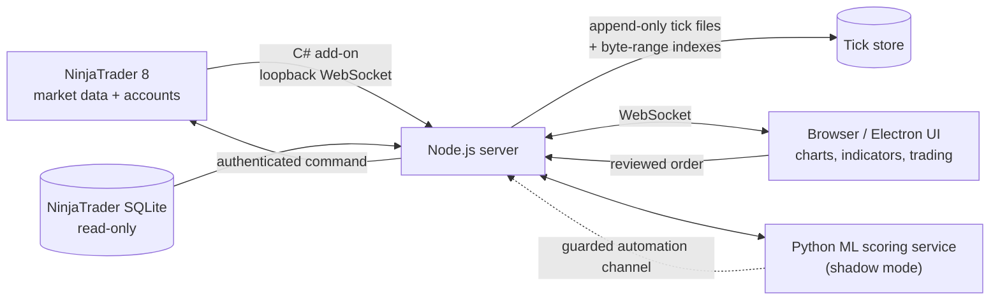

# Turnaround

**An AI-integrated trading, strategy research, and automation platform, built from scratch and run daily against live futures markets.**

Turnaround combines a real-time charting and trading platform with a strategy research lab: a machine-learning scoring service, backtest and forward-test tracking, health monitoring for automated strategies, and a guarded channel for automated execution. It runs locally on one Windows PC, with NinjaTrader 8 as the execution engine.

> This is a showcase repository. Source code and trading strategy logic are private. The README describes the architecture, engineering decisions, and how the system is tested.

---

## AI integration and strategy research

- **Machine-learning scoring service.** A Python service scores market direction on a fixed schedule from an engineered-feature model. It runs in shadow mode and places no orders. On start it self-tests against research history, confirming the platform's live bars reproduce the research data before any reading is trusted.
- **Strategy dashboard.** One screen tracks every strategy's backtest, out-of-sample results, shadow-forward performance, and a live health monitor, and opens any strategy on its chart in one click.
- **Validated strategy translations.** C# strategies are translated into chart indicators and checked against the strategies' native outputs, so what the chart shows matches what the strategy actually computes.
- **Leak-proof replay testing.** Bar replay clips every multi-timeframe input to completed bars, so no future price can leak into a test.
- **Guarded automation channel.** Automated runners place orders only through server-enforced limits: simulation accounts by default, a stop required on every entry, quantity and position caps, a daily loss stop, no opposite-side hedging across related markets, and a full append-only decision log.

## Trading platform

- **Records the full tape.** Every tick for NQ, ES, YM, GC, and their micro contracts is written append-only to disk. Nothing is downsampled or discarded. Byte-range indexes let chart requests skip straight to the time window they need.
- **Multi-chart workspace.** Tiled layouts, linked symbols, second-to-monthly timeframes, session-aware candles built from exchange trading-hours templates, timezone switching, and drawing tools.
- **Custom indicators.** EMA clouds, multi-timeframe EMAs, daily and range levels, ATR, volume, four-stochastics, news-event markers, and a session background, computed in Web Workers so the UI stays responsive.
- **Bar replay.** Replays a single chart or the whole layout from a chosen bar or date. Multi-timeframe indicators are clipped so no future price ever leaks into the replay.
- **Live strategy overlays.** Reads the state of running NinjaTrader strategies and draws their setups, entries, stops, and targets on matching charts, without reimplementing or touching their rules.
- **Chart trading.** Market, limit, stop, and stop-limit orders from the chart, routed to NinjaTrader through a C# add-on, with a review step on every order.
- **Trade history and journal.** Rebuilds past positions from NinjaTrader's execution records (read-only) and reattaches the exact setup that was captured at entry time.
- **Desktop app.** An Electron shell starts NinjaTrader, the chart server, and side services, restarts them if they stop, and keeps recording from the system tray.
- **Trade alerts** for setups across connected accounts.

## Architecture

| Layer | Stack |
| --- | --- |
| Market data and execution bridge | C# NinjaTrader 8 add-on, loopback WebSocket, key-based pairing |
| Server | Node.js 24, `ws`, worker threads for history rebuilds, SQLite (read-only) |
| Front end | Vanilla JavaScript modules, TradingView Lightweight Charts, Web Workers |
| Desktop | Electron shell |
| AI and research | Python machine-learning service (NumPy, SciPy), research parity checks, backtest and forward-test tracking |
| Testing | Node's built-in test runner, browser fixtures, C# compile checks against installed libraries |

## Engineering decisions

**Data integrity first.** Every tick is written synchronously before it is published to charts. Feed batches reuse file handles inside a batch and close them before acknowledging, so performance improves without risking lost data. Reconnects wait for sequence checkpoints so replayed ticks are never duplicated.

**Honest status, never invented numbers.** Missing values show `--`, not zero. A feed is labeled "delayed" when trades are more than 15 seconds old, even if a connection exists. Past trades without a recorded setup show "Setup not recorded" instead of a guess.

**Safety in the trading path.**
- Trading is locked by default. Unlocking requires typing the exact account name and setting a maximum contract count, and expires after 15 minutes.
- Every submit, change, cancel, and flatten passes through a 15-second review that shows the exact account and dated contract.
- Commands are journaled to disk before dispatch, and identical commands are never retried automatically.
- Demo and replay charts cannot submit orders.
- All order handling was developed against a synthetic broker and a simulated account, never a live account.

**Off the hot path.** History reconstruction runs in up to two background workers. The page and live feed stay responsive while recorded ticks are indexed, and cancelled chart requests stop their worker jobs.

## Testing

- **400+ automated tests** across the server, data store, indicators, replay, trading workflows, and UI models.
- Real local WebSocket round trips with isolated accounts, duplicate and restart protection, order-review expiry, price and size checks, rollover, and stale-data rejection.
- Browser workflows (submit, change, cancel, flatten) run against a random-port synthetic broker that never connects to NinjaTrader.
- The C# add-on is compiled against the installed NinjaTrader libraries, and reflection checks confirm strategy field compatibility without executing anything.

## Development approach

Built with AI-assisted, agentic development (Claude and ChatGPT/Codex) inside explicit guardrails: backups before every edit, simulated-account-only order testing, no restarts while live strategies run, and a test suite that has to pass before any change ships.

## Status

In daily use. Current work includes a built-in copy trader for multiple prop-firm accounts and expanded replay tooling.

---

Andrew J. Schultz · [LinkedIn](https://linkedin.com/in/andrewjschultz7)
